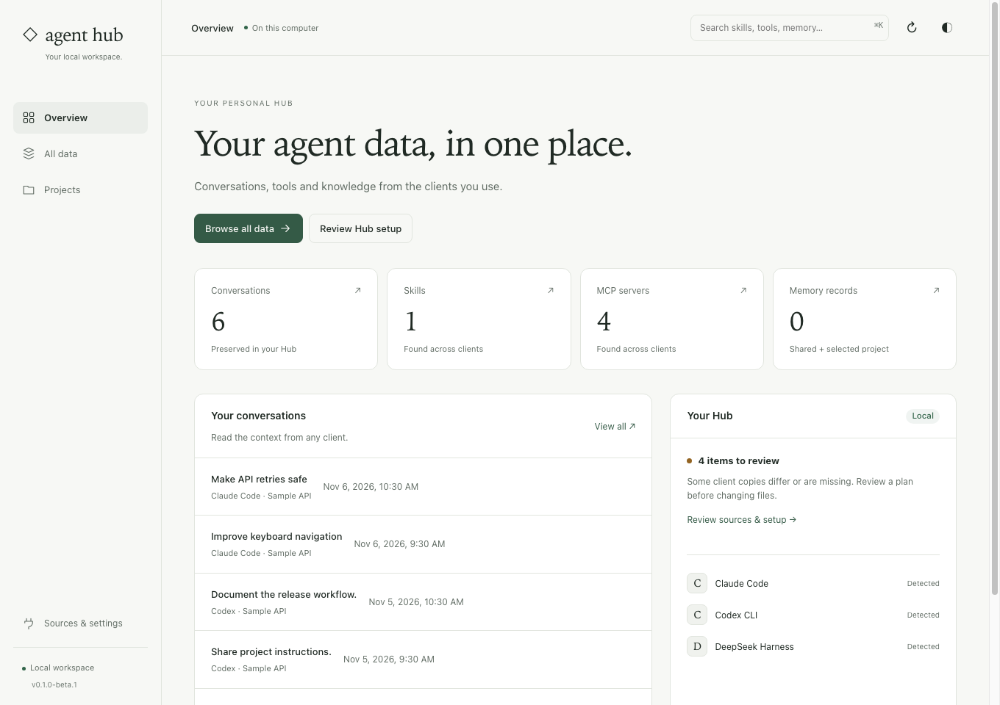
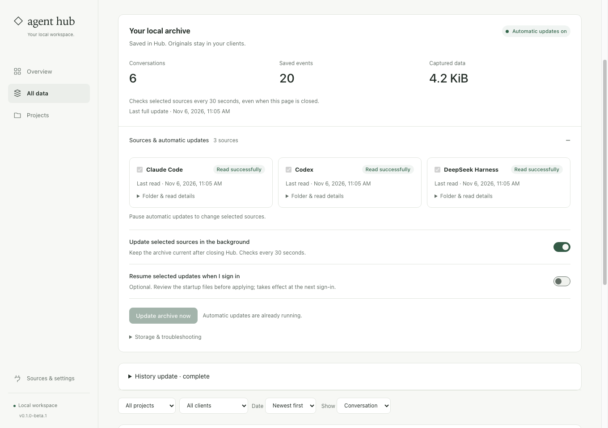
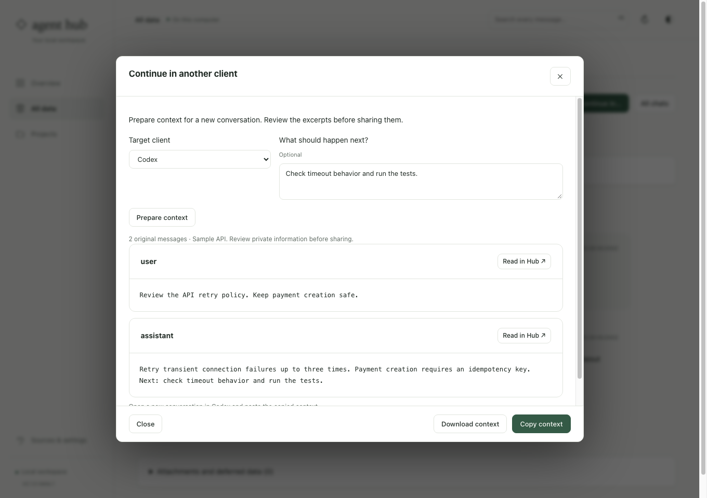

# Agent Hub

One local hub for the chats, projects, MCP tools, skills and memory used by Claude Code, Codex CLI and DeepSeek Harness.

[Quick start](docs/QUICKSTART.md) · [Documentation](docs/README.md) · [Website](https://getahub.dev) · [Releases](https://github.com/get-agent-hub/agent-hub/releases)

## Why Agent Hub?

- Collect existing MCP definitions and complete skill bundles into a shared Hub.
- Deliver Hub settings to selected clients while preserving personal content.
- Connect optional project memory, handoff notes and lifecycle checkpoints.
- Save conversations locally, search messages and keep selected sources updated in the background.
- Prepare context from an archived chat for a new conversation in another client.
- Review changes in the terminal or local UI, with conflict guards and recovery.



Real interface with fictional sample data. [See a saved conversation](docs/images/hub-chat.png) · [Watch the 70-second demo](https://raw.githubusercontent.com/get-agent-hub/agent-hub/master/docs/images/hub-demo.mp4).

| Keep your archive current                                                                                                                               | Continue in another client                                                                                                                                                     |
| ------------------------------------------------------------------------------------------------------------------------------------------------------- | ------------------------------------------------------------------------------------------------------------------------------------------------------------------------------ |
|  |  |

Background updates continue after you close the interface. Optional login startup resumes them after sign-in. **Continue in…** prepares original excerpts and source references to paste into a new chat; active sessions stay in their clients. [How it works](docs/HISTORY.md).

## Get started

Requires **Node.js 22.13+** and npm. macOS and Linux are supported; Windows is experimental. This source is the **0.1.0-beta.3 candidate**. The earlier published **0.1.0-beta.1** archive does not include the current chat and interface features. Use the source checkout while the candidate is being prepared. Public npm registry installation is not available yet.

Clone the source and install a standalone global CLI:

```sh
git clone https://github.com/get-agent-hub/agent-hub.git
cd agent-hub
npm ci
npm run install:global
ahub quick
```

Run `ahub quick` from any folder. It previews shared Hub setup and asks before applying in an interactive terminal. Explicit dry runs and noninteractive calls only preview. Review conflicts, apply the plan and restart affected clients. The default Hub lives at `~/.agent-hub`; no project path is required.

Prefer a graphical workflow? Run `ahub ui`. To connect optional memory for an existing Git project, run `ahub project connect /path/to/project` after Hub setup. See the [quick start](docs/QUICKSTART.md) for setup scope, updates and alternative installation.

## Documentation

| I want to…                                   | Read                                                        |
| -------------------------------------------- | ----------------------------------------------------------- |
| Set up my first Hub                          | [Quick start](docs/QUICKSTART.md)                           |
| Understand commands and their purpose        | [CLI reference](docs/CLI.md)                                |
| Share tools, skills and instructions         | [Content and sync](docs/CONTENT.md)                         |
| Connect memory and automation                | [Memory](docs/MEMORY.md) · [Automation](docs/AUTOMATION.md) |
| Save, search and share past conversations    | [Chats and projects](docs/HISTORY.md)                       |
| Test the complete flow myself                | [Working guide](docs/WORKING_GUIDE.md)                      |
| Undo changes or return to the first baseline | [Recovery](docs/RECOVERY.md)                                |

[All guides and developer documentation →](docs/README.md)

## Contribute

Run `npm ci` and `npm run check` from the source checkout. See [CONTRIBUTING.md](https://github.com/get-agent-hub/agent-hub/blob/master/CONTRIBUTING.md) for development, isolated fixtures and release checks.

[Changelog](CHANGELOG.md) · [Security](SECURITY.md) · [MIT license](LICENSE)

Basic usage analytics is on by default. Turn it off in **Sources & settings → Usage analytics**, with `ahub telemetry off`, or set `DO_NOT_TRACK=1` before running Agent Hub. No chat text, queries, project paths or client configuration are sent. See [analytics settings](docs/UI.md#usage-analytics).
