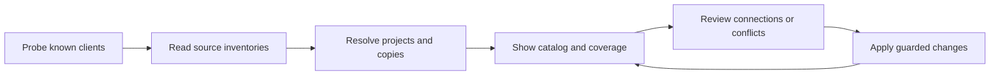

# Automatic discovery and a simple data hub

Implementation proposal · 2026-11-05 · reviewed source `f6d21e4`

Agent Hub should show the data already available in a person's coding clients and keep selected data consistent between them. The person continues working in their own clients. Hub opens to an inventory and synchronization state, without a coordinator, chat composer, code editor or agent launcher.

The normal setup is **open Hub → see discovered data → review Create Hub once**. Projects appear automatically. A later ordinary edit in a connected client needs no import command. Genuine conflicts remain visible instead of being resolved by client order.

**Full conversations are a core requirement.** Every available message and event in the selected supported sources must be preserved and accessible. Titles, summaries and project associations alone do not fulfill the chat feature. The first complete chat reader follows the initial catalog/interface work, before expanding the roster of inventory-only adapters.

This specifies the next implementation, not current beta behavior. Existing [policies](POLICIES.md), [relationships](RELATIONSHIPS.md) and [47 acceptance cases](DELIVERY.md) still apply. This proposal takes precedence over earlier suggestions to require source selection or Find projects before showing the first inventory. Explicit legacy commands retain their documented scopes.

## What the interface shows

Use three main destinations and one search field. Sources are a filter and a management panel, rather than another required setup page. Keep advanced settings and existing power-user commands available.

| Destination | First useful view                                                                    | Main actions                                              |
| ----------- | ------------------------------------------------------------------------------------ | --------------------------------------------------------- |
| Overview    | Found clients, scanned categories, shared-data state and items needing a choice      | Create Hub initially; Sync or Review changes afterward    |
| All data    | One list with type, project and client filters                                       | Inspect an item, choose its audience, review a difference |
| Projects    | Automatically discovered projects and other working folders, with their related data | Open project data; correct a grouping when needed         |

Within All data, start with Skills, MCP, Memory, Instructions and Chats. Show agent presets, plugins, commands, rules and hooks as additional types when present. Do not give every resource type a sidebar page. A plugin can contain several resources; those links should not inflate the count of independent skills or servers.

An item answers four questions: **where it came from, where it is stored, which clients can use it and whether those connections are current**. Show differing copies inside the item. Keep paths, format versions and precedence evidence in Details. Never label a found declaration as confirmed runtime activation.

For example, using illustrative data:

```text
Agent Hub                 Overview   All data   Projects      Search…

Your data
3 clients found · 12 projects · initial scan finished
56 skills · 9 MCP servers · 24 notes · 147 chats found

2 items need a choice                         Review changes

Shared resources                       Available in          State
Review code                            Claude, Codex, DSH    In sync
Issue tracker                          Claude, Codex         Copies differ
Project conventions                    Codex                 Not shared

Sources                                              Manage
Claude · scanned     Codex · scanned     DSH · partial
```

These numbers are examples, not local trial results. Counts distinguish unique resources from client occurrences, and found chats from archived chats. While scanning, use “found so far” and show progress. A failed category has an unknown count, not zero. Show archive completion separately from metadata enumeration.

## Automatic first launch

1. Return the UI shell immediately. Start a cancellable, read-only inventory job without asking for paths or initializing a Hub. Read known client configuration and small session metadata; do not archive transcript bodies in this first pass.
2. Probe known locations, explicit environment overrides and configured profiles. Optional executable/app metadata supplies installation evidence without launching the client. A remaining directory means data exists, not that a client is installed, signed in or running.
3. Publish each source/category independently. One malformed client must not block the rest. The first useful list should appear before a large history finishes.
4. Derive project candidates from native project/workspace records and chat metadata. Inspect supported resource locations in those roots; show ordinary folders separately. Do not turn a home/Desktop cwd into permission to recursively scan that tree.
5. Offer **Create Hub** with supported sources and proposed resource connections selected. Explain the scope in a short review. Unsupported categories remain visible as unavailable or not yet supported, rather than appearing connected.
6. Apply through existing guarded planners and recovery. Keep the inventory usable even if some connections fail. Show collected, connected, skipped and unresolved outcomes separately.

The review includes intended project-memory bindings; users do not register each project or enter its path first. Discovering a project does not itself authorize repository writes, hooks or global sharing. The one setup plan must explicitly cover those actions and scopes. New types of access or OS-protected folders can require their own native approval; Hub cannot silently bypass them.

Implement this one action as scoped orchestration over existing shared setup and selected project-connection planners, with an aggregate review and recorded stage outcomes. Rebuild dependent plans under the existing workflow lock. Do not silently broaden `ahub quick` or pretend a multi-stage setup is one crash-safe filesystem transaction.

After setup, the saved policy permits unchanged connections to synchronize without repeated confirmations. New clients are automatically discovered and shown; connecting them or widening a resource's audience follows the chosen policy and a scoped plan. A new client never silently grants itself access to all projects.

## What can become common data

“All data” means all available categories in each selected supported source, with an honest completeness receipt. It does not include unavailable cloud history, deleted data not preserved elsewhere, private in-memory state or encrypted stores without access.

| Data                                       | Read and preserve                                                                               | Default connection                                                                               |
| ------------------------------------------ | ----------------------------------------------------------------------------------------------- | ------------------------------------------------------------------------------------------------ |
| Skills                                     | Complete bundle, metadata, scripts, references and assets; every native copy                    | Link individual compatible bundles; retain native scope and local variants                       |
| MCP                                        | Definitions, transport, scope and client-specific fields; redact values in the public view      | Shared definition with supported native projections; local permissions remain local              |
| Instructions and rules                     | Original files, imports, directory/path applicability and precedence                            | Supported references or owned sections; no blanket concatenation                                 |
| Native memory                              | Original note, scope, source identity and revisions                                             | Source-aware import and project-bound Hub access; supported native projection only when verified |
| Chats                                      | Native identity, project/locations, lineage, events, attachments and unsupported-field receipts | Read/search in Hub and scoped retrieval from clients; active native logs stay native             |
| Agent presets, plugins, commands and hooks | Definitions and declared resource relationships                                                 | Inventory first; deliver only formats with a verified adapter, without executing them            |
| Client settings                            | Selected non-secret values and scope evidence                                                   | Observe initially; do not homogenize models, permissions or organization policy                  |

Agent Skills are bundles, not just one Markdown file. [Specification](https://agentskills.io/specification). Claude's custom subagents can also declare tools, skills, hooks and persistent memory; preset definitions and actual runs must remain distinct. [Subagent reference](https://code.claude.com/docs/en/sub-agents).

Do not import sign-ins, cookies, API credentials or OS keychain data as shared resources. MCP configuration may contain inline secrets: use the existing private credential extraction path during approved collection and show only references. Raw chat and recovery copies can still contain sensitive text; retain them privately and explain their storage scope. Redacted display is not redaction of preserved originals.

## Complete conversations

Preserve every source-available user message, assistant response, tool call and tool result, including errors and interrupted turns. Retain stored system/developer/context and reasoning blocks when the source exposes them; never reconstruct unavailable internal context. Keep native IDs, ordering, timestamps, edits, regenerations, forks and child-session references where recorded. Preserve original event types even if the first viewer cannot interpret them.

Keep attachment references and original accessible files, with unavailable content explicitly identified. Import complete selected conversations rather than recent-message windows or summaries. Continue incrementally as clients append new messages; partial final records remain pending. Native cleanup does not erase an already preserved Hub conversation.

Offer full conversation reading in All data → Chats and within its project, plus keyword search and scoped client retrieval. Page large conversations for display and model context, while retaining the full underlying contents. A client can request another window; Hub does not push every archived message into every prompt. Native clients keep owning their active session files.

Acceptance requires comparing preserved source bytes and available message/event identities against the fixture source, finding distinctive text in the middle and end of large conversations, and reading it without silent truncation. Include archived/forked/subagent histories, attachment gaps, concurrent appends, interruption/restart and later edits. The current initial-context discovery reader cannot satisfy this gate; it needs a separate full-content read/archive capability.

## Source coverage and reader order

The first milestone offers broad discovery and precise capability labels. Delivery remains restricted to tested writers. The target roster below is not a claim that seven complete adapters already exist.

| Family            | Useful source surface                                                                               | Implementation order and boundary                                                                                                   |
| ----------------- | --------------------------------------------------------------------------------------------------- | ----------------------------------------------------------------------------------------------------------------------------------- |
| Claude Code       | User/project settings, instructions, skills, plugins, presets, auto memory and local JSONL sessions | First complete inventory reader; extend existing metadata reader; preserve subagent logs and large/partial records separately       |
| Codex CLI and app | Config, skill/plugin roots, native memory, thread metadata, native projects and rollouts            | Next reader; CLI/app can share a store. Separate archives, attached/subagent threads, provider filters and pagination explicitly    |
| DSH               | All supported configured profiles, skills/instructions and the selected persistence backend         | Complete the existing adapter; replace discovery's single Hub-selected profile assumption with native profile enumeration           |
| Cursor            | Global/project MCP, native skill/rule roots and plugin metadata                                     | Early inventory reader; chat import only after a versioned local reader or supported export is verified                             |
| OpenCode          | Layered config, skills/instructions and documented project/session/message surfaces                 | Early inventory reader; optional existing local API connection, with verified read behavior; never silently start a server          |
| Gemini CLI        | User/project settings, context, skills/extensions and per-project session files                     | Early inventory reader; obey its root override and retention; no assumption that its hashed directory name proves a project path    |
| VS Code/Copilot   | Profiles/workspace evidence, customization/MCP files and supported exports                          | Inventory before writable integration; separate local, remote and cloud sessions; no claim that one local database holds everything |

Relevant format constraints:

- Claude supports several settings scopes, a relocated config directory and configurable auto-memory storage. A shared memory directory can serve multiple projects. Derive the actual source locations before reading them. [Directory layout](https://code.claude.com/docs/en/claude-directory), [memory locations](https://code.claude.com/docs/en/memory), [settings precedence](https://code.claude.com/docs/en/settings).
- Pinned Codex protocol exposes projects with multiple roots and explicit list filters. A default thread list omits archived and attached classes; list operations can repair metadata unless a supported non-repair path is selected. Feature-gate API use; a database-only view can itself be incomplete. [Thread contract](https://github.com/openai/codex/blob/d4902cedbf508411f6f8bf049cc5919b4edc24f6/codex-rs/app-server-protocol/src/protocol/v2/thread.rs), [project contract](https://github.com/openai/codex/blob/d4902cedbf508411f6f8bf049cc5919b4edc24f6/codex-rs/app-server-protocol/src/protocol/v2/project.rs).
- DSH has versioned, generation-specific plain/Zstandard session files and alternative persistence backends. Preserve format identity and use read mode without migration/repair publication. [Pinned format implementation](https://github.com/deepseek-ai/deepseek-harness/blob/fcc0ad462172522aaf5c93a7b2e01f6b9f0b0159/packages/session/session-persistence-jsonl/src/format.ts), [earlier source analysis](EVIDENCE.md).
- Cursor exposes global/project MCP files and several shared/native skill roots, including compatibility roots. One physical bundle may be visible to several clients; discover it once and retain each visibility relationship. [MCP locations](https://cursor.com/docs/mcp), [skill roots](https://cursor.com/docs/skills).
- OpenCode merges several config layers and exposes project, session, message and event endpoints. Configured, authenticated API access is optional; an endpoint's existence does not prove side-effect-free startup or complete cross-project enumeration. [Config](https://opencode.ai/docs/config/), [server API](https://opencode.ai/docs/server/).
- Gemini documents per-project chat storage, a configurable user root and history cleanup. Parse actual session/project metadata, and archive selected history before its native deletion if preservation is enabled. [Session storage and retention](https://geminicli.com/docs/cli/session-management/), [root configuration](https://geminicli.com/docs/reference/configuration/).
- VS Code documents chat export; use a supported export fallback when a complete local reader is unavailable. Do not require that fallback for ordinary local config inventory. [Session management](https://code.visualstudio.com/docs/agents/run/sessions/manage-sessions).

Custom source addition is the rare fallback: choose a supported format and location once. Adding a path does not teach Hub a new format. Remote/container locations retain their environment identity; no automatic SSH, browser capture, authentication or cloud API calls are part of first launch.

## Implementation with existing code

Keep one core pipeline behind UI, CLI and later automation:



Extend the current adapter registry rather than creating a plugin host. Separate client kind from source instance: a source includes its profile, store, device/environment and format version. Two app surfaces can point to the same store; two profiles of one client can contain independent data.

Add a small optional inventory capability with probe, bounded enumeration and a source receipt. Return original observations before deduplication or effective-config resolution. Reuse the existing `discoverSessions` implementation for its supported subset; keep old adapter callers working.

Store only what the workflow needs: source identities and locations; observed objects with native IDs/revisions/scope; project associations; selected connection policies and acknowledged revisions. Derive reverse links. Names and content hashes alone are not permanent identities. A catalog observation is separate from canonical shared content and the native representation delivered to a client.

For the first discovery screen, keep the pre-setup catalog in the current server job. Once Hub is created, persist a versioned metadata catalog and continuation checkpoints with the existing checked-file infrastructure. Keep source revisions with cursors, serialize writes and retain previous observations during partial scans. A file catalog is sufficient for the initial bounded metadata slice; full-text history indexing needs a separate measured storage decision. Add no graph server, embedding model or mandatory agent SDK solely for detection.

For every category, record scope, adapter/format version, generation/cursor, processed/known counts, unresolved/skipped data, last success and whether enumeration finished. Bound reads, observations, responses and per-pass work separately. Resume after restart only when source bindings still match; otherwise rescan that source without treating old rows as deletions.

Preserve original bytes when selected history is actually archived; normalization and indexes are derived. Fetch/preserve history incrementally, with attachments and unsupported event types accounted for. A title/project index is not a backup. Never symlink incompatible active transcript stores or promise native continuation across clients.

A native SQLite reader needs a consistent, side-effect-checked read/snapshot strategy that accounts for WAL files. Copying only the main live database or forcing immutable mode on a mutable source is insufficient. [SQLite WAL guidance](https://sqlite.org/wal.html#read_only_databases).

## Current gaps to fix first

| Current code                                                                                        | Change needed                                                                                                          |
| --------------------------------------------------------------------------------------------------- | ---------------------------------------------------------------------------------------------------------------------- |
| `ClientAdapter.detect()` exposes only `installed`; adapters mostly infer it from directory presence | Separate data found, executable/app evidence, format support and active connection                                     |
| Codex/DSH `read()` collapse skills into maps keyed by name                                          | Retain every copy and origin; resolve visibility/precedence afterward                                                  |
| `listSkills()` inspects immediate child directories and hides dot entries                           | Add format-specific enumeration, nested/plugin coverage and explicit exclusions; do not blindly share built-ins        |
| Claude config paths and DSH profile selection are resolved partly through Hub defaults              | Respect native relocation/profile evidence independently of a healthy or initialized Hub                               |
| MCP readers primarily return global definitions                                                     | Include selected project/profile definitions with their scope and precedence                                           |
| `collectStatus()` uses a coupled `Promise.all` path                                                 | Isolate results per source/category; reuse the resilient Projects bootstrap principle                                  |
| Projects has explicit Claude-only scanning and ephemeral IDs                                        | Add first-launch inventory orchestration and durable catalog identities after setup; retain explicit legacy behavior   |
| Quick collection skips existing definitions rather than reconciling all later edits                 | Add per-connection comparison and source-aware conflicts through existing planners                                     |
| UI has eight resource/workflow destinations                                                         | Move everyday navigation to Overview, All data and Projects; preserve old actions through item details/advanced routes |

Evidence: [adapter types](../../../src/contracts/clients.ts), [Codex adapter](../../../src/adapters/codex.ts), [DSH adapter](../../../src/adapters/dsh.ts), [skill enumeration](../../../src/shared/fs.ts), [status](../../../src/core/overview/status.ts), [quick orchestration](../../../src/core/setup/quick.ts), [current UI](../../../ui/app/app.js).

## Automation after connection

Run startup reconciliation, bounded incremental reads, debounced watcher hints and periodic rescans through one core service. Watch events can be lost. Suppress self-generated updates by acknowledged revisions, and discover atomic file/link replacements without deleting the replacement. A closed UI should not be presented as continuing background work unless an explicitly enabled worker is running.

Automatically apply changes covered by the saved policy when only one side changed. Preserve both alternatives when they diverged, keep unrelated items moving and show the one necessary decision. Keep global deletion, local removal, disconnect and source outage distinct. Existing scopes, locks, revision checks and recovery remain in force. See [reconciliation policy](README.md#one-reconciliation-path) and [competitive validation cases](OPPORTUNITIES.md#comparative-trial-before-committing-to-a-larger-roadmap).

Resource audience and native scope survive collection: a project-only tool does not become global because Hub found it. Project knowledge needs no model call to catalog; automatic semantic extraction stays a separate supported policy. New cloud access, executable hooks and wider permissions are never implicit consequences of discovery.

## Delivery order and completion gates

| Increment                                  | Reviewable result                                                                                                                 | Completion gate                                                                                                                                                |
| ------------------------------------------ | --------------------------------------------------------------------------------------------------------------------------------- | -------------------------------------------------------------------------------------------------------------------------------------------------------------- |
| 1 · Automatic inventory                    | Open an uninitialized Hub and see three existing adapter families, source errors, all observed variants and auto-derived projects | No client writes/launches; no source/path wizard; a broken unrelated source does not block results; every count has coverage                                   |
| 2 · Simple interface                       | Overview, unified data list and project page share the same catalog                                                               | Search/filter across pages; correct unique/occurrence counts; details explain scope/copies; usable without registration                                        |
| 3 · Full conversations                     | Preserve, read and search all available messages from the first supported source, then Codex/DSH                                  | Complete-content fidelity, branches/events/attachments, source generations, scoped retrieval, incremental updates and restart pass; no summary-only completion |
| 4 · Broader readers                        | Add Cursor, OpenCode and Gemini inventory and verified full-content readers, then VS Code surfaces                                | Per-client fixtures and version receipts; unsupported chat/memory formats remain explicit; shared physical stores not double-counted                           |
| 5 · One connection and reconciliation flow | Review Create Hub, then propagate an approved native MCP edit through Hub to an unchanged peer                                    | Preserve client-only fields, divergent edits, later-work-safe recovery and idempotence; existing CLI callers remain compatible                                 |
| 6 · Memory and automatic refresh           | Source-aware project memory and selected history stay current under saved policy                                                  | Scoped access, concurrent/stale writes, source changes, missed watcher events, retention, restart and disconnect pass                                          |

Increment 1 is narrow enough to implement next. Broader detection and read support must not imply broader write support. Full history is a real requirement with its own gate; it is neither hidden behind a finished metadata screen nor expanded into an IDE.

Validate this sequence with the existing C01–C47 and T01–T12 cases plus first-launch fixtures for: no clients; an existing Hub; data without an installed app; two profiles; one store seen through CLI/app; shared skill roots; nested/plugin resources; relocated roots; protected/corrupt sources; ordinary home/Desktop cwd; offline remote roots; a source changing during scan; and incomplete history/attachments. Test install/runtime fixtures on the supported Node/OS matrix. Real users should finish initial connection and find a known item without assistance; claims of completeness or simplicity need those results.

For this proposal, source reading and a bounded local metadata availability check were performed. No client files were changed and no complete seven-client import or usability trial was run. Existing implementation evidence remains in [the discovery review](DISCOVERY_REVIEW.md); the new increments above are pending.
