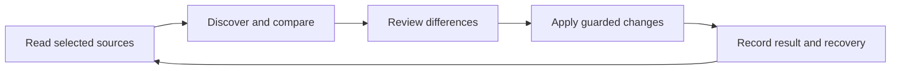

# A simpler Agent Hub

Research and design proposal · 2026-11-05 · reviewed core: `06c4960`.

**Status: proposed, not implemented.** This consolidates the earlier simplification and relationship reviews. The released beta still has MCP-only `sync`, setup-run recovery and no shared chat archive. This proposal does not change that contract.

Agent Hub should find your clients, collect the content you choose, and keep it available across those clients. Projects should appear from existing chat and client metadata. Users should not have to build a catalog before receiving useful results.

- [Relationships: what can be discovered and what needs a choice](RELATIONSHIPS.md)
- [Evidence: client contracts, limitations and implementation costs](EVIDENCE.md)
- [Delivery plan and acceptance cases](DELIVERY.md)

## One ordinary workflow

1. **Choose clients and content.** Show detected sources and Add client. Tools, skills, instructions and notes can be shared without selecting a project. Offer chat discovery and a local archive with an explanation of what will be stored.
2. **Review and connect.** Show a short result: items collected, client settings affected, projects found and differences requiring a choice. Expand details per item. Confirm the operation once.
3. **Use the clients normally.** One Sync action collects later changes and updates connected clients. Automatic updates are an optional persisted setting using the same rules.

These are two setup screens followed by the normal app, not a wizard for each content type. Start showing discovered metadata while larger archives are still being read. A permission error in one source must not discard results from another.

The normal navigation has three destinations:

| Destination | What the user finds                                                                    |
| ----------- | -------------------------------------------------------------------------------------- |
| Shared      | Tools, skills, instructions and notes available across clients                         |
| Projects    | Automatically discovered projects, their chats, project notes and applicable resources |
| History     | Changes made by Hub, unresolved differences and recovery                               |

Clients, source locations, automatic updates and advanced diagnostics belong in Settings. Chats are inside projects, with an All chats view for search and conversations without a known project. History means Hub operations; it must not be confused with conversation history.

At first launch, use a small illustration of the actual result, not a command catalog: “Your clients → Agent Hub → your clients.” The explanation is: **“Collect once. Keep your clients in sync.”** Show the actual capability status beside each client; do not imply every client can share every kind of data.

## Discover relationships instead of asking for setup

A chat often supplies a working folder. Git can identify its repository and worktrees. Client scope rules then identify relevant tools, skills, instructions and notes. Explicit parent IDs reveal related chats; structured events can identify tools used and files changed. These relationships can be found without a model call. See the [relationship catalog](RELATIONSHIPS.md) and [source evidence](EVIDENCE.md).

The result should look like a useful project page, not an editable graph:

```text
Storefront                              Sync
3 clients · 2 working folders

Chats       Notes       Tools & skills
Fix checkout validation        Claude Code · today
Review the payment adapter     Codex · yesterday

1 item needs a choice: payment-tool differs in Codex.
```

“Project” is a user grouping, not necessarily one Git repository. Respect a client's explicit project assignment when available. Otherwise use verified folders and repository identity as a starting grouping. Allow Rename, Move chat and Combine projects without requiring those steps initially. An ordinary non-Git folder is useful too.

Discovering a project grants no new write permission. Reading its chat metadata does not authorize changing repository files, enabling hooks or sharing its notes globally. Keep discovered projects separate from existing write-authorized memory/project bindings until the user connects them.

## One Hub, several native representations

Hub owns selected shared definitions and the local archive. Clients keep native runtime settings, credentials, permissions and active session state. A generated config entry or a skill link is a view of Hub content. That distinction belongs in code and item details; the user only needs to know where an edit will apply.

| Content      | Simplest supported connection                                                                   |
| ------------ | ----------------------------------------------------------------------------------------------- |
| Skills       | Link individual complete bundles, including scripts and assets                                  |
| MCP tools    | Generate the client's supported entry pointing to a Hub launcher; preserve client-only settings |
| Instructions | Use supported references or managed sections, respecting native precedence                      |
| Notes        | Use a compatible native directory where supported; otherwise import and expose through Hub      |
| Chats        | Preserve source events in Hub and provide read/search access; keep live session writers native  |

Do not link whole client config directories or make incompatible clients write the same active transcript. Some native formats cannot round-trip every field. An adapter must report what it can preserve before offering a writable connection.

Current Hub memory records require metadata that arbitrary native Markdown does not have. Preserve native notes and their source metadata first; retain the existing structured record API for its callers. A derived view can search both. Do not migrate every note merely to make the storage diagram smaller.

## One reconciliation path

Reuse the current quick orchestration, planners, guarded writers, locks and recovery. Extend the adapter boundary so the CLI, UI and optional worker call the same sequence:



Compare Hub and each connected client with the last acknowledged version of that connection. Compare portable meaning, including scope; keep generated launchers and client-only overrides separate from shared content.

| Observation                           | Action under the user's selected policy                 |
| ------------------------------------- | ------------------------------------------------------- |
| Neither side changed                  | Do nothing                                              |
| Only the client changed               | Collect its edit, then update unchanged connected views |
| Only Hub changed                      | Update unchanged connected views                        |
| Both changed to the same meaning      | Acknowledge; avoid an unnecessary rewrite               |
| Both changed differently              | Preserve both; ask which version to use for this item   |
| Explicit deletion of a managed item   | Record removal; do not revive it from an old copy       |
| Source unavailable or scan incomplete | Retain known content; report what could not be checked  |

Deletion needs a defined policy. Removing a connection, removing an item from one client and deleting shared content are different actions. Confirm the intended scope; retain a deletion record so stale copies cannot silently resurrect the item. Deleting a native chat never automatically deletes the Hub archive.

A change through an intact symlink already changes the Hub target. Index it once. If a client replaces the link with a file, detect that drift and compare the new copy. A generated Hub launcher must never be reimported as a new tool that launches itself. Same names, URLs or timestamps are insufficient for either identity or conflict resolution.

One conflict should not block independent items. The operation result records completed, skipped and failed stages. Existing multi-file writes offer compensating rollback; they are not a crash-safe transaction. Keep later-edit checks when undoing, and keep Restore original setup as a separate rare recovery action.

## Small internal model

Extend existing stores and adapters rather than introducing an entity framework. The minimum extra records are:

| Record           | Purpose                                                                                       |
| ---------------- | --------------------------------------------------------------------------------------------- |
| Source           | Stable local identity for a client store/profile/environment, capabilities and format version |
| Observation      | Native object ID, revision/cursor, origin and the facts actually read                         |
| Project          | Stable Hub ID, label, native aliases and associated locations                                 |
| Connection state | Selected scope/policy, last acknowledged versions and deletions                               |
| Archive entry    | Source-qualified chat identity, preserved native data and derived metadata                    |

Use generated stable Hub IDs. Paths are locations and content hashes are revisions/equivalence checks, not permanent identity. Store a relationship on its owner when possible; derive cheap reverse lookups. Keep an origin reference for each discovered relation so Details can explain it. Do not add a generic edge table or numeric confidence system unless a real query requires it.

Client app, agent preset and agent run are distinct. A preset declares behavior and dependencies; a run belongs to a chat. Likewise a CLI and an IDE can show the same stored conversation. Source-qualified native IDs prevent duplicate views without merging unrelated stores.

Start a rebuildable metadata catalog using existing file infrastructure. Archive storage is authoritative; search indexes are disposable. Evaluate Hub-owned SQLite/FTS when full-text search needs it, with the minimum supported Node version and dependency cost tested. No graph server, mandatory embeddings or new background infrastructure is needed for the first catalog.

## Automation without hidden work

One optional worker performs startup reconciliation, watches supported source locations and periodically rescans. Watch events are hints; they can be missed. Debounce changes, read stable content, suppress self-generated events and use the existing Hub lock. Bound each pass and persist progress so a large history does not freeze the UI. [Syncthing documents the same need for periodic scans alongside watchers.](https://docs.syncthing.net/users/syncing.html)

The setup choice should say “Keep connected clients updated automatically,” explain whether a startup service will be installed, and persist the selected content/write policy. Starting a foreground watcher is a separate lifecycle action. Conflicts stay pending; approved independent changes continue. Native memory extraction hooks remain optional semantic capture, not a second general synchronization engine.

Archive selected chats locally. Display size/progress and allow pause/exclusions. Do not automatically add transcripts, credentials or indexes to a Git repository. Index useful conversation text and safe metadata, not credential fields from configs. Shared archive access through Hub MCP should return search results and fetch selected content, not load all chats into every prompt.

## Clear language and honest status

Use recognition, visible outcomes and secondary details rather than a glossary in the main flow. These are design principles, not evidence that this particular UI has passed a usability study. [Usability heuristics](https://www.nngroup.com/articles/ten-usability-heuristics/) and [progressive disclosure](https://www.nngroup.com/articles/progressive-disclosure/) support this approach.

| Main UI, English            | Main UI, Russian                 | Technical detail kept behind Details        |
| --------------------------- | -------------------------------- | ------------------------------------------- |
| Up to date                  | Всё синхронизировано             | Last successful comparison and its coverage |
| Changes found               | Есть изменения                   | Planned imports/projections                 |
| Choose a version            | Выберите версию                  | Three-way conflict and revisions            |
| Could not check Claude Code | Не удалось проверить Claude Code | Source error and last successful scan       |
| Use the Codex version       | Использовать версию из Codex     | Item-scoped resolution                      |
| Undo this change            | Отменить это изменение           | Recovery stages and later-edit guard        |

Show scan/archive progress when work is ongoing; never say Up to date for sources not checked. Distinguish “Configured” from runtime tool health: an intentionally stopped n8n server can be unavailable while its shared configuration is correct. Do not recommend rewriting its settings just because a health request failed.

## CLI and documentation

Target five ordinary entry points: `ahub`, `ahub ui`, `ahub sync`, `ahub status`, `ahub undo`. With a terminal, `ahub` opens guided setup/update. Without a terminal it must not unexpectedly prompt or broaden writes. Keep existing commands, JSON contracts and runtime callbacks working as advanced interfaces.

**Compatibility gate:** current `sync` is MCP-only and `undo` covers setup runs. Introduce all-content reconciliation explicitly, for example `sync --all`, before any versioned change to defaults. Do not document the target as today's command behavior. No new commands are needed for relationship graphs, identities or confidence.

The landing should explain the outcome, three steps, one example and recovery. Documentation should offer five entry guides: Get started, Clients and shared data, Sync and differences, Notes and chats, Recovery. Preserve current deeper routes/anchors and technical references. Keep locale-owned text and the EN/RU schema; command references should continue to derive from code. This proposal belongs in contributor navigation, not the beginner quick start.

## Implementation direction

First deliver source metadata and automatic projects together with one clear setup/sync experience. Then make all-area reconciliation and recovery real, add the optional worker, and incrementally preserve/search chats. Native cross-client continuation is a later, separately verified adapter capability. Until then, offer reading the archive, opening the original chat, or creating a new conversation with selected context.

The [delivery plan](DELIVERY.md) specifies concrete slices and failure cases. Preserve existing useful services; remove duplicate user journeys first, then consolidate internal code where two real callers share behavior. A smaller menu alone is not completion.

The follow-up [coverage review](DELIVERY.md#additional-boundaries-found-in-the-follow-up-review) adds access isolation, multi-client races, archive assets/edits, storage failures, portability and disconnect. These remain required design/test outcomes, not claims of completed verification.
